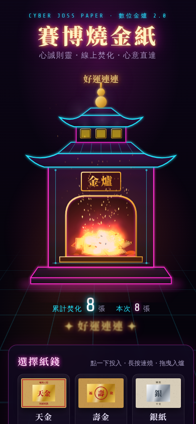

# 賽博燒金紙 Cyber Joss Paper

賽博龐克霓虹風格的線上燒金紙網頁（2.0 重製版）。

- **霓虹金爐**：SVG 繪製的雙層飛簷金爐，葫蘆頂、爐口火光與煙囪通風口會隨火勢明暗閃爍。
- **六種紙錢**：天金、壽金、銀紙、天地銀行冥鈔、賽博冥幣、願望紙（可自訂文字），圖樣皆以 Canvas 即時繪製。
- **逐像素燃燒**：紙錢落入爐中後由一角點燃，焦黃、發光火線、炭化、碎裂成灰，火星與灰燼沿燃燒邊緣飛出。
- **三種投法**：點一下拋入、長按連續燒一疊、拖曳到金爐放開。
- **音效**（預設關閉）：Web Audio 合成的爐火低鳴、劈啪聲與投入時的呼嘯聲。
- 累計焚化數存於瀏覽器 localStorage；支援 iPhone 觸控、鍵盤操作與「減少動態效果」設定。

- 線上版：https://elan7192.github.io/cyber-joss-paper/
- 純靜態網頁，無建置步驟：`index.html`、`style.css`、`script.js`
- 本機預覽：`python3 -m http.server` 後開啟 http://localhost:8000

## 決策紀錄

| 項目 | 內容 |
|---|---|
| 誰 | Firstmate（代船長 Captain 執行） |
| 何時 | 2026-10-15 |
| 為何 | 船長要求製作一個「賽博燒金紙」網頁 |
| 決定 | 公開 repo，以便免費使用 GitHub Pages |
| 2.0 重製 | 2026-10-15 依使用者要求重做：重繪金爐、逐像素燃燒、新增紙錢種類與長按／拖曳投入 |

本頁僅供娛樂與心意表達，敬天惜福。
